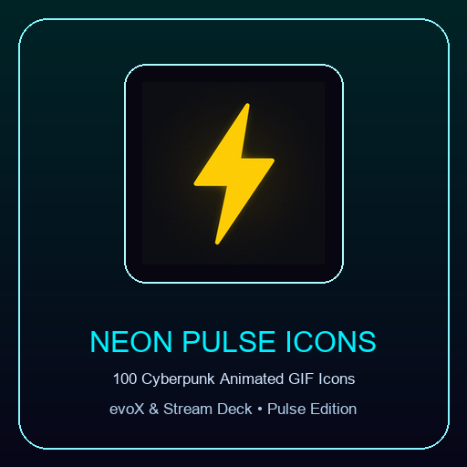

  
  <h1>Neon Pulse Icons (100 Animated Icons)</h1>
  
<strong>Cyberpunk Neon Pulse Animated GIF Icon Suite for Elgato Stream Deck & evoX (Action Toggles & Brand Suites).</strong>

  

    <strong>Language / Dil:</strong> <a href="README.md"><strong>English</strong></a> | <a href="README.tr.md"><strong>Türkçe</strong></a>
    &nbsp;•&nbsp;
    <a href="https://github.com/Hfatih/neon-pulse-icons/releases/latest">Download .evoxpack</a> ·
    <a href="https://hfatih.github.io/neon-pulse-icons/">Live Interactive Gallery</a> ·
    <a href="#installation--usage">How to Install</a>
  

  

    
    
    
    
    
    
    
  

  

    
    
    
    
    
  

---

## 🕹️ Live Interactive Web Simulator & Gallery
Preview all 100 neon animated icons on a live 15-key virtual Stream Deck hardware simulator:  
👉 **[Open Live Simulator on GitHub Pages](https://hfatih.github.io/neon-pulse-icons/)**

- **Dual-State Toggles:** Easily preview active vs. offline toggle animations.
- **Search & Brand Filtering:** Fast search across actions, streaming controls, and brands.
- **Direct Download:** Download `Neon Pulse Icons.evoxpack` with one click.

---

## 📖 Overview
**Neon Pulse Icons** is a high-contrast cyberpunk animated icon suite featuring electric cyan and neon magenta line animations on pure dark backgrounds.

Includes dedicated dual-state toggles for Stream Deck:
- **Audio & Mic:** Mic On / Off, Sound Mute / Unmute, Headset Active / Off
- **Connectivity:** WiFi On / Off, Bluetooth On / Off, Airplane Mode On / Off
- **Security:** Padlock Open / Closed, Shield Active / Alert
- **Streaming & Social Brands:** Discord, Twitch, YouTube, Spotify, Steam, GitHub

---

## 🚀 Installation & Usage
- **Stream Deck:** Drag `.gif` files from `icons/` onto keys in Stream Deck software.
- **evoX Action Deck:** Download and open `Neon Pulse Icons.evoxpack` from [Releases](https://github.com/Hfatih/neon-pulse-icons/releases/latest).

---

## 📄 License
Released under the [MIT License](LICENSE).
